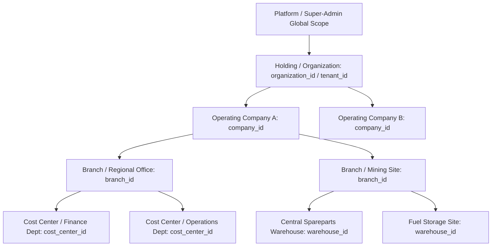
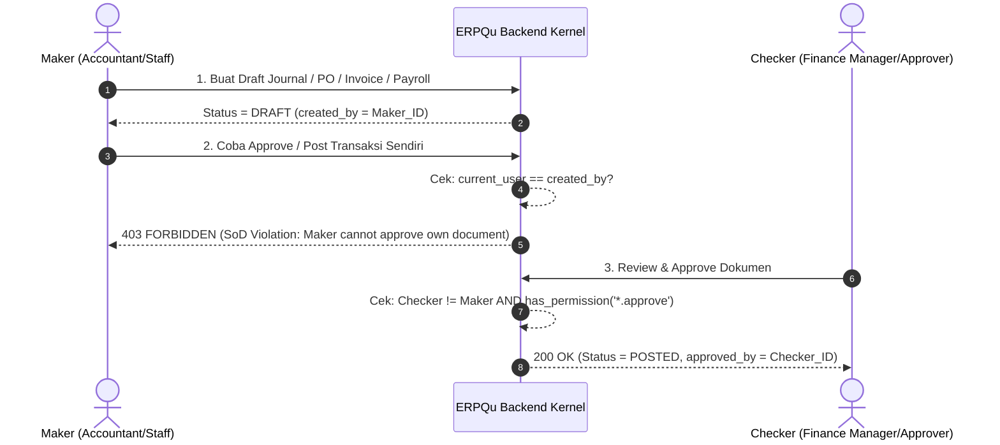

# Arsitektur Multi-Tenant, RBAC, Segregation of Duties (SoD), dan Row-Level Security (RLS)

## 1. Struktur Hierarki Organisasi dan Tenancy



### Definisi Field Tenancy Data
| Field Database | Tipe Data | Cakupan / Scope | Aturan Isolasi |
| :--- | :--- | :--- | :--- |
| `organization_id` | `UUID` | Holding / Grup Perusahaan | Batas multi-tenant paling tinggi. Tidak ada data transaksi yang dapat melintasi `organization_id` berbeda. |
| `company_id` | `UUID` | Entitas Legal / PT Operasional | System of Record keuangan (General Ledger, Jurnal, Bank, Payroll). Default boundary untuk seluruh data transaksi. |
| `branch_id` | `UUID` | Cabang / Site Tambang / Proyek | Lokasi fisik operasional dan penugasan karyawan serta armada. |
| `cost_center_id` | `UUID` | Pusat Biaya / Departemen | Akuntansi biaya dan pelaporan laba rugi divisi. |
| `warehouse_id` | `UUID` | Gudang / Lokasi Penyimpanan | Buku besar persediaan (*Stock Ledger*) dan pelacakan batch/serial. |

---

## 2. Matriks Data Sharing vs Data Isolation

| Tipe Data / Entitas | Kebijakan Sharing | Keterangan & Batasan |
| :--- | :--- | :--- |
| **Chart of Accounts (COA)** | *Shared with Company Override* | Standar akun induk ditetapkan di tingkat Holding; pemetaan akun kas/bank dispesifikasikan per PT (`company_id`). |
| **Item Master & UOM** | *Global Catalog / Shared* | Katalog barang & satuan dapat dibagikan; level persediaan & harga beli unik per `company_id` & `warehouse_id`. |
| **Customer / Vendor Master** | *Shared with Local Ledger* | Master kontak dapat diakses grup, tetapi transaksi AR/AP & termin kredit terisolasi per `company_id`. |
| **Journal Entries & General Ledger** | **Strictly Isolated (Per-Company)** | Tidak boleh ada jurnal lintas legal entity tanpa transaksi Intercompany Elimination yang sah. |
| **Stock Ledger & Warehouses** | **Strictly Isolated (Per-Company)** | Mutasi barang antar entitas legal wajib menggunakan mekanisme Sales Order / Purchase Order resmi. |
| **Payroll & Tax (PPH 21 / BPJS)** | **Strictly Isolated (Per-Company)** | Data gaji dan kepatuhan pajak terikat langsung pada entitas hukum pemberi kerja (`company_id`). |

---

## 3. Model Role-Based Access Control (RBAC)

### A. Konvensi Penamaan Permission (Dot-Notation)
Format: `<domain>.<entity>.<action>`
Contoh:
- `finance.journal.create` / `finance.journal.post` / `finance.journal.reverse`
- `inventory.stock_entry.create` / `inventory.stock_entry.submit`
- `procurement.purchase_order.approve`
- `hr.payroll.calculate` / `hr.payroll.disburse`

### B. Matriks Role Default
| Role Code | Level | Cakupan Akses | Izin Kunci |
| :--- | :--- | :--- | :--- |
| `super_admin` | 0 | Global Platform (Maintenance Only) | `platform.*`, audit access |
| `holding_auditor` | 1 | Multi-Company (Read-Only) | `*.read`, `report.*` lintas anak perusahaan |
| `company_director` | 1 | Full Operating Company | `*.approve`, `finance.report.*`, `approval.*` |
| `finance_manager` | 2 | Financial Domain Approval | `finance.journal.post`, `finance.payment.approve` |
| `accountant_maker` | 3 | Financial Entry Creation | `finance.journal.create`, `finance.invoice.create` |
| `warehouse_keeper`| 3 | Inventory Execution | `inventory.stock.create`, `inventory.delivery.create` |
| `technician` | 4 | Field Operations | `ops.work_order.update`, `telemetry.read` |

---

## 4. Segregation of Duties (SoD) & Maker-Checker Enforcements

Untuk mematuhi standar audit keuangan dan ISO/IEC 27001, sistem memberlakukan aturan pemisahan tugas secara otomatis di level backend (*fail-closed*):



### Aturan SoD Wajib:
1. **Purchase Order**: `created_by != approved_by`.
2. **Vendor Bill & AP Disbursement**: Petugas pencatat faktur dilarang merilis/menyetujui pembayaran bank.
3. **Journal Entry**: Petugas pembuat voucher jurnal dilarang mem-posting jurnal ke General Ledger (`created_by != posted_by`).
4. **Stock Adjustment**: Operator gudang pembuat draft penyesuaian stok dilarang melakukan submit/approval akhir.
5. **Payroll**: Penyusun rekap gaji dilarang melakukan persetujuan pencairan (*disbursement approval*).

---

## 5. Arsitektur Row-Level Security (RLS) PostgreSQL

Sistem menerapkan prinsip **Defense-in-Depth** dengan menggabungkan otentikasi middleware aplikasi dan isolasi baris data PostgreSQL RLS.

### Implementasi Session Parameter PostgreSQL
Saat koneksi diambil dari pool untuk menangani request, middleware backend mengatur session context:
```sql
-- Dijalankan pada setiap transaksi query request
SET LOCAL app.current_tenant_id = 'c1a74d2b-5813-4414-9b16-f64e22295a01';
SET LOCAL app.current_company_id = 'e7b1a03f-912b-4228-8d82-c8913b762512';
SET LOCAL app.current_user_id = 'fa42b899-73e4-4d83-8a39-df033d59bc41';
```

### Kebijakan RLS Template (Tabel Transaksional)
```sql
-- Aktifkan RLS pada tabel
ALTER TABLE public.journal_entries ENABLE ROW LEVEL SECURITY;
ALTER TABLE public.stock_ledger_entries ENABLE ROW LEVEL SECURITY;
ALTER TABLE public.payroll_entries ENABLE ROW LEVEL SECURITY;

-- Kebijakan Isolasi Multi-Company
CREATE POLICY company_isolation_policy ON public.journal_entries
    FOR ALL
    TO erpqu_app
    USING (
        company_id = NULLIF(current_setting('app.current_company_id', true), '')::uuid
        OR (current_setting('app.is_super_tenant', true) = 'true')
    );
```

---

## 6. Persyaratan Audit Trail yang Tidak Dapat Diubah (Immutable)

Setiap mutasi data sensitif (Finance, Inventory, HR, Auth) wajib dicatat dalam tabel `public.audit_logs`:
- **ID Transaksi & Identitas**: `id`, `user_id`, `company_id`, `action` (`CREATE`/`UPDATE`/`DELETE`/`POST`/`CANCEL`).
- **Payload Perubahan**: `prior_state` (JSONB snapshot sebelum perubahan) dan `post_state` (JSONB snapshot setelah perubahan).
- **Metadata Jaringan**: `ip_address`, `user_agent`, `timestamp` (UTC).
- **Immutability Guarantee**: Tabel `audit_logs` dilindungi oleh trigger PostgreSQL yang menolak operasi `UPDATE` dan `DELETE` untuk seluruh role non-superuser.
