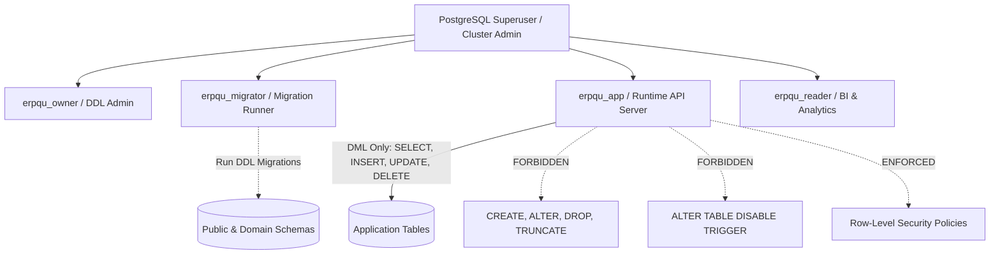

# Spesifikasi Pemisahan Hak Akses Role Database PostgreSQL

## 1. Prinsip Least Privilege & Fail-Closed
Untuk menjamin integritas data akuntansi dan mencegah eskalasi hak akses saat terjadi kompromi aplikasi, sistem memisahkan hak akses database ke dalam empat role PostgreSQL independen.



---

## 2. Matriks Definisi Role & Batasan Hak Akses

| Nama Role | Kegunaan & Komponen | Hak Akses yang Diberikan (Permitted) | Hak Akses yang DILARANG (Forbidden) |
| :--- | :--- | :--- | :--- |
| `erpqu_owner` | Schema Ownership & DDL Admin | Owner seluruh schema, database, dan extensions | Dilarang digunakan untuk koneksi runtime aplikasi |
| `erpqu_migrator` | Dedicated Migration Job (`Dockerfile.migrate`) | `CREATE TABLE`, `ALTER TABLE`, `CREATE INDEX`, `CREATE TRIGGER`, `CREATE POLICY` | Dilarang digunakan sebagai connection pool di backend API |
| `erpqu_app` | Runtime Backend (`crates/api-server`) | `SELECT`, `INSERT`, `UPDATE`, `DELETE` pada tabel operasional | **DILARANG**: `CREATE`, `ALTER`, `DROP`, `TRUNCATE`, disable triggers, bypass RLS |
| `erpqu_reader` | BI, Reporting, & Read-Only Replica | `SELECT` pada view dan tabel pelaporan | `INSERT`, `UPDATE`, `DELETE`, DDL |

---

## 3. SQL Template Pembuatan Role (Production Bootstrap)

```sql
-- 1. Buat Role Migrator (Khusus deployment/migrasi)
CREATE ROLE erpqu_migrator WITH LOGIN PASSWORD '<MIGRATOR_PASSWORD>';
GRANT ALL PRIVILEGES ON DATABASE erpqu_management_system TO erpqu_migrator;
GRANT ALL ON SCHEMA public TO erpqu_migrator;

-- 2. Buat Role Runtime Aplikasi (Least Privilege)
CREATE ROLE erpqu_app WITH LOGIN PASSWORD '<APP_RUNTIME_PASSWORD>';
GRANT CONNECT ON DATABASE erpqu_management_system TO erpqu_app;
GRANT USAGE ON SCHEMA public TO erpqu_app;

-- Berikan hak DML hanya pada tabel yang ada
GRANT SELECT, INSERT, UPDATE, DELETE ON ALL TABLES IN SCHEMA public TO erpqu_app;
GRANT USAGE, SELECT ON ALL SEQUENCES IN SCHEMA public TO erpqu_app;

-- Atur default privileges agar tabel baru otomatis dapat diakses DML oleh erpqu_app
ALTER DEFAULT PRIVILEGES IN SCHEMA public GRANT SELECT, INSERT, UPDATE, DELETE ON TABLES TO erpqu_app;
ALTER DEFAULT PRIVILEGES IN SCHEMA public GRANT USAGE, SELECT ON SEQUENCES TO erpqu_app;

-- 3. Batasi Hak Akses DDL erpqu_app
REVOKE CREATE ON SCHEMA public FROM erpqu_app;
```
