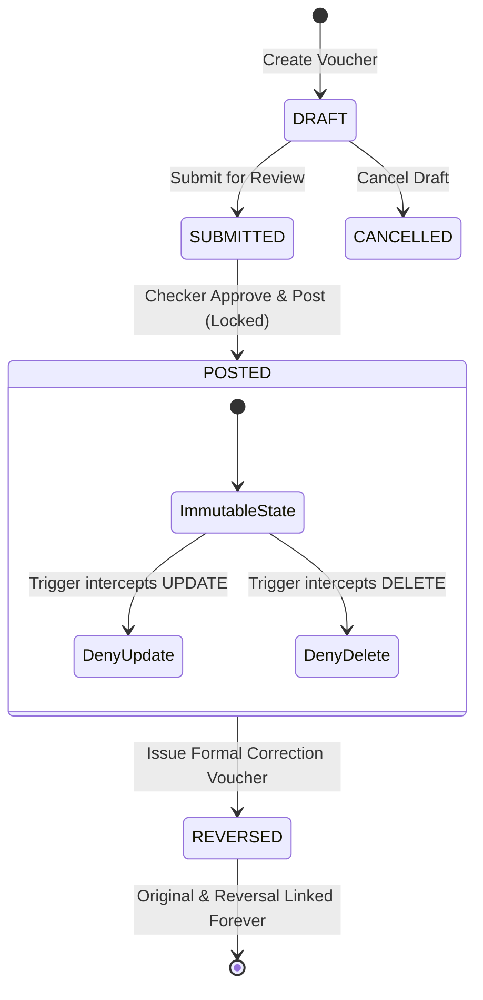
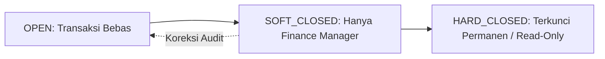

# Spesifikasi Desain Trusted Finance & Immutable Ledger Kernel (Fase 7)

Dokumen ini mendefinisikan arsitektur dan fondasi matematis sistem akuntansi double-entry, buku besar yang tidak dapat diubah (*immutable ledger*), presisi uang non-floating point, penutupan periode fiskal, dan rekonsiliasi otomatis untuk ERPQu.

---

## 1. Double-Entry Accounting Invariants

```mermaid
graph LR
    subgraph Transaction[Journal Voucher Envelope]
        DebitLines["Debit Lines (Σ Debit)"]
        CreditLines["Credit Lines (Σ Credit)"]
    end
    
    DebitLines --> BalanceCheck{"Σ Debit == Σ Credit?"}
    CreditLines --> BalanceCheck
    
    BalanceCheck -->|Zero Discrepancy (Diff = 0.0000)| PostToGL["Post ke general_ledger_entries (Immutable)"]
    BalanceCheck -->|Out of Balance (Diff != 0)| Halt["Circuit Breaker: ABORT POSTING (Fail-Closed)"]
```

### Invariant Matematis Wajib
1. **Zero Discrepancy Balance Rule**:
   $$\sum_{i=1}^{n} \text{Debit}_i - \sum_{j=1}^{m} \text{Credit}_j = 0.0000$$
   Setiap voucher jurnal (apapun jenisnya: General Journal, Sales Invoice, Purchase Bill, Payment Entry, Stock Voucher, Depreciation) wajib seimbang sempurna sebelum dibukukan ke General Ledger.
2. **Explicit Currency Conversion**:
   - Setiap baris jurnal memuat: `account_currency`, `exchange_rate` (presisi 8 desimal), `amount_currency`, dan `amount_company_currency`.
   - Transaksi dalam mata uang asing (misal USD) dikonversi ke mata uang dasar entitas (IDR) pada tanggal posting.
3. **Foreign Exchange (FX) Gain/Loss**:
   - **Realized FX Gain/Loss**: Dihitung otomatis saat pelunasan faktur valas (*payment settlement*).
   - **Unrealized FX Gain/Loss**: Dihitung pada akhir periode penutupan buku (*period-end revaluation*) berdasarkan kurs tengah Bank Indonesia / JISDOR.

---

## 2. Arsitektur Buku Besar yang Tidak Dapat Diubah (Immutable Ledger)



### Aturan Ketahanan Buku Besar (Ledger Inviolability)
1. **Append-Only General Ledger**: Tabel `general_ledger_entries` murni bertindak sebagai *write-once-read-many* (WORM) storage.
2. **Larangan `UPDATE` dan `DELETE`**:
   - Trigger PostgreSQL menolak seluruh operasi `UPDATE` dan `DELETE` pada baris transaksi berstatus `POSTED`.
   - Dilarang keras melakukan hard-delete atau modifikasi nilai angka setelah transaksi berstatus `POSTED`.
3. **Mekanisme Reversal & Amendment**:
   - Koreksi transaksi dilakukan melalui penerbitan **Jurnal Pembalik Eksplisit** (*Explicit Reversal Voucher*).
   - Jurnal pembalik memuat relasi Foreign Key eksplisit `reverses_journal_id` ke dokumen asli, membalik posisi debit/kredit secara akurat dengan alasan bisnis yang tercatat pada `audit_logs`.

---

## 3. Representasi Uang & Presisi Desimal (Zero Floating-Point Error)

### Larangan Mutlak `f32` dan `f64`
Untuk mencegah *floating-point rounding error* (misal $0.1 + 0.2 = 0.30000000000000004$), seluruh kalkulasi moneter, kuantitas stok, dan rasio pajak wajib menggunakan tipe data desimal eksak:

| Layer / Bahasa | Tipe Data Wajib | Presisi & Skala | Penggunaan |
| :--- | :--- | :--- | :--- |
| **Rust Domain Kernel** | `rust_decimal::Decimal` | 128-bit Fixed-Point | Perhitungan keuangan, pajak, amortisasi, depresiasi |
| **PostgreSQL Database**| `NUMERIC(28, 8)` / `NUMERIC(20, 4)` | Skala 4 desimal (Uang IDR), Skala 8 desimal (Kurs & Stok) | Kolom saldo, debit, kredit, exchange rate |
| **Frontend Web Admin** | `string` / `Decimal.js` | Dilarang konversi ke Javascript `Number` mentah | Formatting mata uang, parsing input pengguna |

### Aturan Pembulatan (Rounding Policy)
- Menggunakan **Banker's Rounding / Half-Even Rounding** (IEEE 754-2008) untuk mendistribusikan bias pembulatan secara merata pada transaksi volume tinggi:
  - Nilai desimal $0.5$ dibulatkan ke angka genap terdekat ($2.5 \rightarrow 2$, $3.5 \rightarrow 4$).

---

## 4. Pengelolaan Periode Finansial & Penutupan Buku (Period Closing)

### Status Periode Fiskal


1. **`OPEN`**: Seluruh pengguna berhak dapat mencatat transaksi pada tanggal dalam periode ini.
2. **`SOFT_CLOSED`**: Periode ditutup untuk operasional harian (Sales/Purchasing/Inventory); hanya role `finance_manager` yang dapat mem-posting jurnal penyesuaian akhir bulan (*Month-End Adjusting Entries*).
3. **`HARD_CLOSED`**: Periode terkunci permanen setelah audit tahunan selesai. Database menolak seluruh posting transaksi yang memiliki `posting_date` dalam periode ini.

### Year-End Closing & Retained Earnings Rollover
- Pada akhir tahun fiskal, sistem menghasilkan **Closing Journal** otomatis:
  1. Menutup seluruh saldo akun Pendapatan (Akun Kelas 4) dan Beban (Akun Kelas 5 & 6) ke akun Ikhtisar Laba Rugi (*Income Summary*).
  2. Memindahkan saldo bersih laba/rugi ke akun **Saldo Laba Ditahan** (*Retained Earnings - 31000*).
  3. Mengunci periode tahun fiskal menjadi `HARD_CLOSED`.

---

## 5. Multi-Company & Akuntansi Antar-Perusahaan (Intercompany Accounting)

### Mekanisme Due-To / Due-From
Saat terjadi transaksi antar anak perusahaan dalam satu grup (misal PT A meminjamkan kas ke PT B atau memasok sparepart ke PT B):
1. **Buku PT A**:
   - Debit: `11910 - Piutang Hubungan Istimewa (Due from PT B)`
   - Kredit: `11110 - Kas / Bank`
2. **Buku PT B**:
   - Debit: `11110 - Kas / Bank`
   - Kredit: `21910 - Utang Hubungan Istimewa (Due to PT A)`
3. **Laporan Konsolidasi Holding**:
   - Sistem menghasilkan **Jurnal Eliminasi Konsolidasi** (*Elimination Voucher*) otomatis untuk mengeliminasi akun `Due from` dan `Due to` sehingga tidak terjadi *double-counting* pada neraca grup.

---

## 6. Standar Struktur Chart of Accounts (COA) Indonesia

Mengacu pada Standar Akuntansi Keuangan (SAK) Indonesia:

| Kelas Akun | Nama Kelompok Akun | Normal Balance | Pelaporan Finansial |
| :--- | :--- | :--- | :--- |
| **1xxxx** | **Aset / Aktiva** (Lancar, Tetap, Tak Berwujud) | **DEBIT** | Neraca (*Balance Sheet*) |
| **2xxxx** | **Liabilitas / Kewajiban** (Lancar, Jangka Panjang)| **KREDIT** | Neraca (*Balance Sheet*) |
| **3xxxx** | **Ekuitas / Modal** (Modal Saham, Saldo Laba) | **KREDIT** | Neraca (*Balance Sheet*) |
| **4xxxx** | **Pendapatan Usaha** (Rental, Penjualan, Layanan) | **KREDIT** | Laba Rugi (*Profit & Loss*) |
| **5xxxx** | **Harga Pokok Penjualan (HPP)** / Biaya Operasi Unit| **DEBIT** | Laba Rugi (*Profit & Loss*) |
| **6xxxx** | **Beban Operasional & Umum** (Gaji, Penyusutan, Sewa)| **DEBIT** | Laba Rugi (*Profit & Loss*) |
| **7xxxx** | **Pendapatan Non-Operasional** (Bunga, Laba Valas)| **KREDIT** | Laba Rugi (*Profit & Loss*) |
| **8xxxx** | **Beban Non-Operasional** (Pajak Bunga, Rugi Valas)| **DEBIT** | Laba Rugi (*Profit & Loss*) |

---

## 7. Rekonsiliasi, Trial Balance, dan Circuit Breaker

### Real-Time Trial Balance Circuit Breaker
- Sebelum commit transaksi jurnal ke General Ledger, engine memvalidasi:
  ```rust
  if total_debit != total_credit {
      return Err(FinanceError::OutOfBalance {
          debit: total_debit,
          credit: total_credit,
          discrepancy: total_debit - total_credit,
      });
  }
  ```
- Jika terdeteksi selisih $\neq 0$, transaksi otomatis di-*rollback* total (*atomic Unit of Work*), mencegah korupsi neraca saldo.

### Tri-Partite Sub-Ledger Reconciliation
1. **Rekonsiliasi Bank**: Saldo buku kas/bank dicocokkan otomatis terhadap mutasi rekening koran (*Bank Statement Feed*).
2. **Rekonsiliasi Sub-Ledger AR / AP**: Total saldo pada kartu piutang/utang per kontak wajib sama persis dengan akun kontrol `11300 - Piutang Usaha` dan `21100 - Utang Usaha` di GL.
3. **Rekonsiliasi Persediaan (Perpetual Inventory to GL)**: Total nilai persediaan pada seluruh gudang di `stock_ledger_entries` wajib setara dengan saldo akun `11400 - Persediaan Barang Dagang/Material` di GL.
