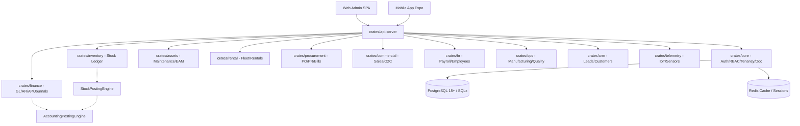

# Baseline Verification dan Change Map ERPQu (Fase 0)

## 1. Metadata Baseline & Snapshot Repository

- **Repository Target**: `https://github.com/Rusdinsjs/erp-system.git`
- **Audit Baseline Commit**: `b9839e966f55eb551523541b9c2f095d979bf347`
- **Current HEAD**: `b9839e966f55eb551523541b9c2f095d979bf347` (Sinkron dengan baseline audit)
- **Active Branch**: `master`
- **Working Tree Status**:
  - `M migrate.log` (Local runtime log file)
  - `D "crates/core/tests/test_architecture_harness_tests.rs7929"` (Malformed path entry)
  - `?? crates/core/tests/test_architecture_harness_tests.rs:79:29` (Untracked artifact)

---

## 2. Inventarisasi Komponen & Metrik Kuantitatif

| Komponen | Volume / Metrik | Keterangan |
| :--- | :--- | :--- |
| **Cargo Workspace Crates (Aktif)** | 12 crates | `api-server`, `assets`, `commercial`, `core`, `crm`, `finance`, `hr`, `inventory`, `ops`, `procurement`, `rental`, `telemetry` |
| **Rust Source (Workspace Aktif)** | 460 files, 68.382 baris | Terletak di direktori `crates/` |
| **Rust Source Legacy** | 380 files, 58.342 baris | Terletak di direktori `/src` (di luar workspace `Cargo.toml`) |
| **Common Filenames (/src vs /crates)** | 239 files | Duplikasi nama domain & handler lama |
| **Database Migrations** | 205 files | Terletak di `migrations/*.sql` |
| **Tabel Database (DDL)** | 310 tabel unik | Didefinisikan via `CREATE TABLE` pada migrasi |
| **API Endpoints (Axum Routes)** | ~398 routes | Didaftarkan pada `crates/api-server/src/api/routes/` |
| **OpenAPI Annotations (`#[utoipa::path]`)** | 24 anotasi | Cakupan dokumentasi swagger masih sangat minim (~6%) |
| **Service Layer Files** | 68 files | Tersebar di 12 crates modular |
| **Repository Layer Files** | 71 files | SQLx-backed repositories |
| **Web Admin (Frontend)** | 177 pages, ~90.887 baris | React 18, Vite, Tailwind CSS, TypeScript, Zustand |
| **Web Admin API Clients** | 63 files | Terletak di `web-admin/src/api/` & `web-admin/src/services/` |
| **Web Admin Unit Tests** | 5 test files, ~295 baris | Cakupan test UI & state sangat minim |
| **Mobile App (React Native/Expo)** | 19 screens, ~51.133 baris | React Native Expo TypeScript |
| **Mobile App Unit Tests** | 6 test files | Belum terintegrasi dalam CI workflow |
| **Rust Test Files** | 25-39 files, ~2.355 baris | 1 test integration database nyata, sisanya unit/AST tests |
| **CI/CD Workflows** | 2 workflows | `.github/workflows/ci.yml` & `deploy.yml` |

---

## 3. Analisis Dua Generasi Arsitektur

1. **Active Modular Workspace (`/crates`)**:
   - Terdiri dari 12 domain crates terisolasi dengan root `crates/api-server` sebagai router agregator.
   - Menggunakan Unit of Work (`UnitOfWork`), `StockPostingEngine`, dan rintisan `AccountingPostingEngine`.
2. **Legacy Monolith (`/src`)**:
   - Memiliki 380 file `.rs` yang tidak lagi didaftarkan dalam `[workspace]` `Cargo.toml`.
   - Mengandung duplikasi handler, service, dan schema lama yang membingungkan developer.
   - Perlu dihapus secara formal setelah dipastikan seluruh fitur telah ekuivalen di `/crates`.

---

## 4. Domain Ownership & Dependency Mapping

---

## 5. Klasifikasi Risiko & Vulnerability Matrix

### A. Critical Severity (P0 - Insiden Keamanan & Integritas)

1. **Exposed Secrets & Sensitive Data in Git Tracking**:
   - File `.env`, database dump `erpqu_backup_latest.sql` (~715 KB), log runtime (`backend.log`, `backend_backtrace.log`), login request artifacts (`login_req.json`), dan asset uploads (~100+ files) terlacak aktif di repositori publik.
2. **Hardcoded Super-Admin Authentication Backdoor**:
   - File: `crates/core/src/application/services/auth_service.rs:37-61`
   - Ketika lookup email `admin@example.com` / `org.admin@example.com` gagal atau mengalami database error, sistem mengembalikan user `super_admin` dengan fixed Argon2 hash dan `Uuid::nil()`.
3. **Migration Fail-Open & Privileged Fallback**:
   - File: `crates/api-server/src/main.rs:51-83`
   - Kegagalan migrasi hanya menghasilkan warning dan server tetap berjalan.
   - Jika koneksi runtime gagal, koneksi otomatis fallback memakai `MIGRATION_DATABASE_URL` yang berhak akses DDL penuh (melanggar least privilege).

### B. High Severity (P1-P2 - Integritas Keuangan & Tenancy)

1. **Optional Accounting Posting Engine & Silent Journal Posting**:
   - File: `crates/finance/src/journal_service.rs:141-180`
   - `PostingEngine` bertipe `Option`. Jika `None`, status jurnal diubah menjadi `Posted` tanpa mencatat GL entry.
   - Menggunakan hardcoded `Uuid::nil()` sebagai company ID, `IDR`, dan exchange rate 1.
2. **Unpost Reversal Violation & Draft Mutation**:
   - File: `crates/finance/src/journal_service.rs:201-220`
   - Error reversal diabaikan (`let _ = engine.reverse_voucher_in_uow(...)`), kemudian jurnal posted diubah paksa kembali menjadi `Draft`.
3. **Weak RBAC & Blanket Admin Bypass**:
   - File: `crates/api-server/src/api/middleware/rbac.rs:134-160`
   - Role `admin`, `super_admin`, dan `role_level <= 2` melewati seluruh pemeriksaan otorisasi (bypass).
   - Pemetaan izin hanya berdasarkan HTTP Method (GET->view, POST->create, PUT->edit, DELETE->delete) tanpa aksi spesifik ERP (`submit`, `approve`, `post`, `cancel`, `reverse`).
4. **Token Leakage via URL & LocalStorage**:
   - File: `web-admin/src/utils/image.ts:18-22` & `web-admin/src/store/useAuthStore.ts`
   - JWT token ditambahkan ke parameter query URL gambar (`?token=...`) dan disimpan permanen di `localStorage`.
5. **CI Quality Gates Non-Blocking**:
   - File: `.github/workflows/ci.yml:90-100`
   - `continue-on-error: true` pada scanning Gitleaks dan Cargo Security Audit.
   - Frontend tidak menjalankan lint, unit test, atau build bundle. Mobile gate tidak ada.

### C. Medium Severity (P3-P4 - Multi-Company & Document Flows)

1. **Inconsistent Multi-Company Scope**:
   - Mayoritas repository dan query SQL belum menerima `company_id` sebagai parameter wajib.
   - RLS PostgreSQL baru aktif di beberapa tabel finance dan memperbolehkan `company_id IS NULL`.
2. **Subledger & Payment Allocation Disconnect**:
   - Alokasi pembayaran belum sepenuhnya mengupdate outstanding invoice secara persisten dan atomik di database subledger.
3. **Payroll Hardcoded Regulations & Float Usage**:
   - Aturan TER/BPJS masih ada yang ter-hardcode tanpa versioning/effective date yang fleksibel.

### D. Low Severity / Technical Debt (P5-P7)

1. **OpenAPI Documentation Coverage**: Hanya 24 dari ~400 routes yang memiliki dokumentasi utoipa.
2. **Legacy Source Residue**: Direktori `/src` sebesar 58k baris membebani repository.

---

## 6. Audit Test Suite: Behavioral vs Semu

- **Total Rust Test Files**: 25-39 files
- **Real Database Integration Test**: 1 file (`crates/finance/tests/sales_invoice_real_db_integration_tests.rs`)
- **AST / Source String Matching Tests**:
  - `crates/core/src/architecture_boundary_tests.rs`: Menguji string token di dalam file source Rust menggunakan `fs::read_to_string`.
  - `crates/core/tests/masterplan_completion_seal_tests.rs`
- **Behavioral Invariant Tests**:
  - `crates/core/tests/golden_invariants_suite_tests.rs` (20 tests)
  - `crates/core/src/kernel_invariant_tests.rs` (16 tests)
  - `crates/finance/tests/accounting_kernel_invariant_tests.rs` (4 tests)
  - `crates/assets/tests/asset_eam_invariant_tests.rs` (4 tests)

---

## 7. Audit Database Migrations (205 Files)

- **Total Migrations**: 205 files
- **Migrasi Mengandung Hardcoded Password / Credentials Seed**:
  - `001_init_schema.sql`, `0026_add_specialist_users.sql`, `0027_add_remaining_users.sql`, `0030_seed_employees.sql`, `0031_seed_more_employees.sql`, `0032_update_emp_name_demo.sql`, `005_add_rbac.sql`, `011_seed_data.sql`, `014_enhanced_rbac.sql`, `20260121140000_reset_passwords.sql`, `20260807000001_create_frappe_style_rbac.sql`, `20260807000002_create_frappe_style_workflows.sql`, `20260817000001_phase2_tenancy_and_hierarchy_baseline.sql`.
- **Migrasi Destruktif (`DROP TABLE` / `TRUNCATE`)**:
  - `20260124125900_cleanup_approval_workflows.sql` (`DROP TABLE`)
  - `20260127000100_standardize_indonesian_coa.sql` (`TRUNCATE`)
  - `20260811010000_complete_all_stock_doctypes.sql` (`DROP TABLE`)
  - `20260811020000_complete_selling_doctypes.sql` (`DROP TABLE`)

---

## 8. Anti-Pattern Codebase Scanner Results

| Anti-Pattern | Temuan | Contoh Lokasi Kritis |
| :--- | :--- | :--- |
| `Uuid::nil()` | 15 occurrences | `crates/finance/src/journal_service.rs:142`, `crates/core/src/application/services/auth_service.rs:41` |
| `.unwrap()` | 86 occurrences | Handler dan parsing JSON |
| `.expect(...)` | 27 occurrences | Startup `crates/api-server/src/main.rs:43,81` |
| `let _ =` (Ignored Errors) | 105 occurrences | `crates/finance/src/journal_service.rs:201` (ignored reversal result) |
| `f32` / `f64` in Finance & HR | 15 occurrences | Beberapa kalkulasi TER/BPJS & formula amortisasi |

---

## 9. Daftar Keputusan & Persetujuan Pengguna

1. **Repositori Publik vs Privat**: Repositori saat ini publik dan melacak credentials/dump. Repositori wajib di-set Private oleh pengguna, diikuti rotasi seluruh credentials eksternal dan git history purge.
2. **Pembersihan /src Legacy**: Penghapusan direktori `/src` (58k baris) setelah migrasi penuh diverifikasi pada fase akhir.
3. **Pemisahan Seed Demo dari Migrasi Inti**: Migrasi yang memuat demo credential tidak boleh dieksekusi di production environment.

---

## 10. Roadmap Hardening Bertahap (Fase 1 - 14)

- **Fase 1**: Repository Security Containment & Super-Admin Fallback Removal
- **Fase 2**: Trusted CI and Strict Quality Gates
- **Fase 3**: Database Privilege Separation & Migration Safety
- **Fase 4**: Authentication, Session, Token, WebSocket, & Upload Hardening
- **Fase 5**: Tenant, Authorization, & Segregation of Duties Design
- **Fase 6**: Tenant, RBAC, SoD, & RLS Implementation
- **Fase 7**: Trusted Finance Kernel Design
- **Fase 8**: Trusted Finance Kernel Implementation
- **Fase 9**: AR, AP, Payment Allocation, Cash, & Bank Subledger
- **Fase 10**: Order-to-Cash, Procure-to-Pay, & Inventory Integrity
- **Fase 11**: ERPQu Vertical Differentiation (EAM, Rental, Fleet, Telemetry)
- **Fase 12**: Payroll & Indonesian Tax/BPJS Localization
- **Fase 13**: Platform, API, Observability, Backup, & Disaster Recovery
- **Fase 14**: Release Readiness Assessment & Controlled Pilot Plan
